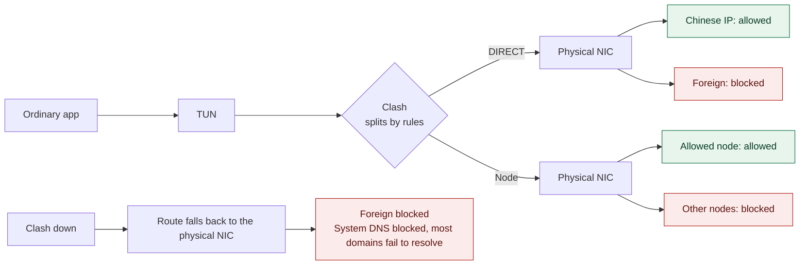
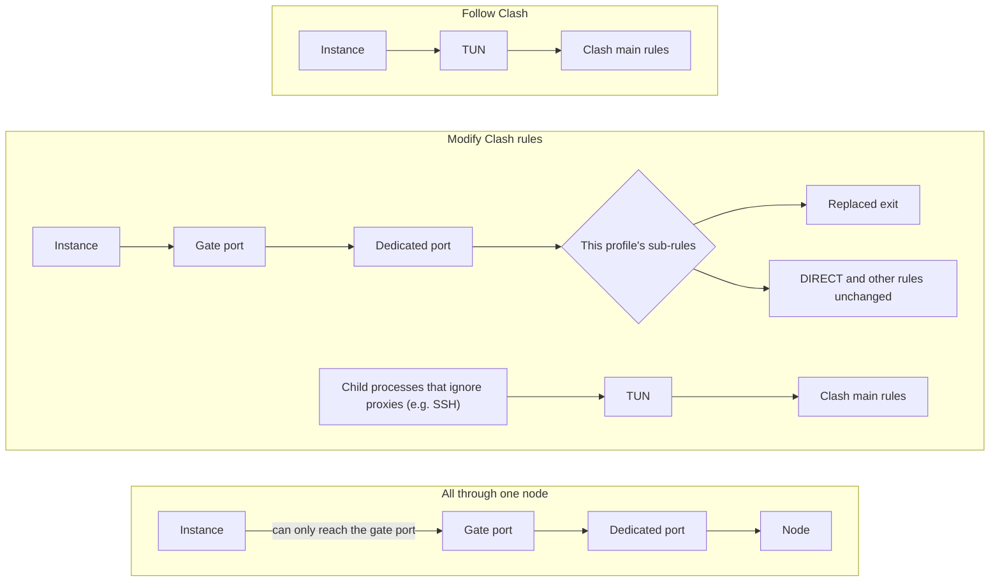
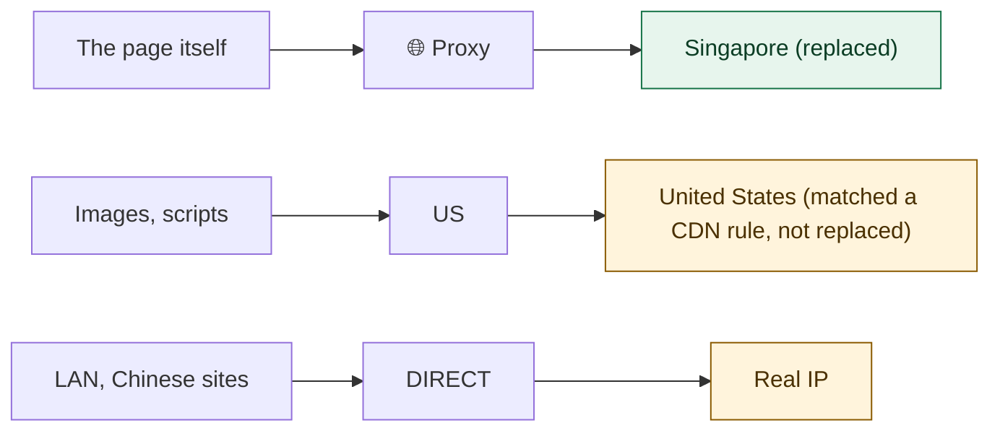

<div align="center">

[简体中文](README.md) · **English**


# SandGate

**Keep your real IP hidden when Clash fails, and give each app its own exit**

[](#quick-start)
[](#quick-start)
[](#automatic-sync-to-clash)
[](#development)
[](LICENSE)

[Quick start](#quick-start) · [Whole-Mac protection](#whole-mac-protection) · [Sandbox instances](#sandbox-instances) · [Troubleshooting](#troubleshooting) · [Commands](#commands)

</div>

<br>

SandGate is a macOS tool that works alongside Clash Verge and is configured through a web page. It solves two problems:

- **Your real IP stays hidden when Clash breaks:** when the TUN fails or Clash is updating, ordinary apps do not quietly connect to foreign sites directly, and they do not switch to a node you have not allowed.
- **Some apps can use a different exit:** you can run several copies of the same app, each with its own IP, while `git`, SSH and the LAN keep working for them.

It has two independent parts, and you can use either one alone:

| | Whole-Mac protection (pf) | Sandbox instances |
|---|---|---|
| Scope | Every app on the Mac | Apps started by SandGate |
| How traffic flows | Split by Clash rules; the physical NIC can only reach allowed targets | Decided by the instance's network profile |
| Requirements on the app | None | None for "Follow Clash"; other profiles need proxy support |
| When a node goes down | Traffic through that node fails; nothing else is affected | Only instances using that node are affected |
| Needs root | Yes | No |

> [!NOTE]
> The web UI is currently in Chinese only. Where this document names a page or button, the Chinese label follows in parentheses.

## Contents

- [Quick start](#quick-start)
- [Pages](#pages)
- [Whole-Mac protection](#whole-mac-protection)
- [Sandbox instances](#sandbox-instances)
- [Troubleshooting](#troubleshooting)
- [Commands](#commands)
- [File locations](#file-locations)
- [Security](#security)
- [Not yet verified](#not-yet-verified)
- [Design notes](#design-notes)
- [Development](#development)
- [License](#license)

## Quick start

Requires Node 20 or later and Clash Verge. There are no other dependencies.

> [!IMPORTANT]
> **Run every command below in an ordinary terminal.** `sandbox-exec` cannot be nested; inside an already sandboxed environment, instances fail with exit code 71.

1. **Start SandGate:** install it as a background service that starts at login.

   ```bash
   cd ~/sandbox
   node bin/sandgate.js service install
   node bin/sandgate.js url    # print the login link with its token
   ```

2. **Connect to Clash:** enable external control in Clash Verge, then click "Read from Clash Verge" (从 Clash Verge 读取) on the **Settings** (配置) page.

3. **Turn on whole-Mac protection (optional):** on the **Settings** page, enter the nodes or groups to allow, save, then run:

   ```bash
   sudo bash scripts/sandgate-pf.sh install
   ```

4. **Create an instance:** on **Overview** (总览), click "New instance" (新建实例). The default "Follow Clash rules" needs no setup. To change the exit, first create a profile on the **Network profiles** (网络配置) page.

5. **Check:** every item on the **Environment check** (环境检查) page should pass. Before starting an instance, you can run the "Leak self-test" (泄漏自检) once.

## Pages

| Page | Purpose |
|---|---|
| **Overview** (总览) | Whole-Mac protection status, instance gates, the instance list. Instances can be grouped by network profile or by application; the choice is saved in the current browser |
| **Network profiles** (网络配置) | Create and edit network profiles and sync them to Clash manually. The page explains where rules come from and how exits are replaced |
| **Settings** (配置) | Clash controller, the whole-Mac allow-list, the expected exit IP, gate check parameters |
| **Environment check** (环境检查) | Checks `sandbox-exec`, routing, Clash, IPv6, dedicated ports and sync status one by one |

## Whole-Mac protection

The physical NIC can reach only four kinds of targets: allowed nodes, Chinese IPs, mihomo's bootstrap DNS, and the LAN. pf only looks at the destination address; it cannot tell which app sent a packet.



> [!WARNING]
> **When Clash is down, almost every app that relies on domain names goes offline, including WeChat and Chinese sites.** This is a deliberate trade-off: allowing the system DNS would keep Chinese sites working, but every domain you visit would be sent to the DNS server in plaintext.

### What install does

`install` copies the script to `/usr/local/sbin/sandgate-pf` and registers the root LaunchDaemon `com.sandgate.pf`. The rules live under the `com.apple/sandgate` anchor; `/etc/pf.conf` is not modified.

- **Loading:** rules are loaded once when the service starts. For the first 10 minutes after boot it confirms every 30 seconds that the rules are in effect, because macOS also loads `/etc/pf.conf` at boot and the order is not fixed.
- **Later `pfctl` calls:** only when the allow-list changes or a new interface appears. There is no periodic reload.
- **When the service exits:** the rules stay; the list just stops updating. launchd restarts it after a crash.
- **List unreadable at boot:** the last validated copy is used.
- **Early boot:** there is an unprotected window before the rules load, usually before login and before Clash starts.

To try it first, run `trial`, which reverts automatically when time is up (at most 86400 seconds). `ALLOW_LAN=0` removes the LAN, multicast and link-local allowances; the setting chosen at install time is kept.

### Recovering from problems

> [!CAUTION]
> **Once installed, rebooting does not clear the rules.**

1. If you can get into the system, run `sudo /usr/local/sbin/sandgate-pf uninstall`.
2. If two consecutive boots end abnormally within 10 minutes (panic, forced shutdown), the service stops loading rules until you run `install` again. Whole-Mac protection is then off; the page shows it as inactive, and `status` says so too. Clean shutdowns do not count.
3. If the crash happens more than 10 minutes after boot, this safeguard does not trigger; uninstall manually while you still can.

### How the allow-list is updated

Enter the node or group names to allow on the **Settings** page. Every 15 seconds SandGate reads the config generated by Clash Verge and works out which IPs the physical NIC actually needs to reach. pf checks every 30 seconds and only updates when the list changes.

- **Groups:** expanded to all members, so nodes added or removed by the subscription are followed automatically.
- **Chained nodes:** for a node with `dialer-proxy`, its dialer is allowed rather than the node itself, since the node's own server is only reached through the dialer.
- **Nodes used by instances:** allowed automatically, including exits replaced in network profiles.
- **Read failures:** if the config cannot be parsed or no node can be selected, the previous list stays in use and the page warns you.
- **Nodes whose server is a domain name:** only nodes with IPv4 addresses are supported. Nodes given by domain are not allowed and therefore cannot connect; the page warns you.
- **proxy-provider:** nodes inside it cannot be read; the page warns you.
- **When SandGate is not running:** the list stops updating. Nodes whose IP changed in the subscription will fail to connect, but nothing leaks.

The list file is written by a non-root process, and the root script validates it strictly every time: nodes and DNS must be single IPs, network prefixes must be at least /8, reserved addresses are refused, and any anomaly rejects the whole file. A malicious program running as the same user could still add IPs to the list.

### Connection guard and status probe

- **Connection guard:** checks Clash's connections every 2 seconds. Connections through the wrong node are closed. When the main rules change, Overview shows "Clash rules changed" (Clash 规则已变化); it also warns when Clash is not in `rule` mode.
- **Protection probe:** every 60 seconds it makes a TCP handshake from the physical NIC to an Apple address (`17.253.144.10:443`), and if that fails, to `223.5.5.5:443`, to decide whether protection is in effect. When protection is not in effect, these handshakes are real direct connections.
- **Restrict rule-split traffic to one node (optional):** usually left empty, since the allow-list already limits which nodes can be used. When set, any rule-split connection that uses neither this node nor DIRECT is closed within about 2 seconds. Do not set it when several nodes are allowed.

### Limits of whole-Mac protection

- **Chinese IPs stay directly reachable while Clash is down.** pf cannot tell apps apart, so any app that knows an IP or brings its own DNS can connect, and the other side sees your real IP. The allowed bootstrap DNS can likewise be used by any app.
- **A wrong rule means a real direct connection.** Sites classified as `DIRECT` see your real IP.
- **Clash must stay in `rule` mode.** In `direct` or `global` mode, traffic is no longer split by rules.
- **`DIRECT` to foreign IPs fails.** Add such targets to "Extra allowed" (额外放行) if needed, but any app can then reach them directly while Clash is down.
- **Allowed nodes are not pinned against each other.** With several nodes allowed, Clash may switch among any of them, including automatic switching in `url-test` groups.
- **Nodes whose address is in the Chinese IP list cannot be blocked,** for example nodes using a domestic relay.
- **IPv6 on the physical NIC is mostly unusable.** Only LAN and link-local addresses remain; nodes and Chinese IPv6 are not allowed.
- **New interfaces have up to a 30-second gap.** Interfaces plugged in after install only enter the rules at the next check. Trials do not follow new interfaces, so those are unprotected after being plugged in.
- **Physical interfaces other than `en` are not covered,** such as Bluetooth PAN.

## Sandbox instances

An instance is defined by two things: the **network profile** decides how traffic flows, and the **data environment** decides how files are isolated. Any combination works, and one network profile can serve many instances.

### Network profiles

| Profile | How traffic flows | `git`, SSH, LAN | App needs proxy support? | Exit guaranteed by |
|---|---|---|---|---|
| **Follow Clash rules** (default) | Split by Clash rules like any ordinary app | Work normally | No | Clash |
| **Modify Clash rules** | Based on Clash rules, with chosen exits replaced and optional extra rules | See below | Yes | Clash |
| **Everything through one node** | All traffic goes through this node | Apps that ignore proxies cannot connect | Yes | The system |
| **No network** | Cannot go online | Unavailable | N/A | The system |



**Which to choose:**

- **You only want file isolation, network as usual:** Follow Clash rules.
- **You want a different IP while `git`, SSH and the LAN keep working:** Modify Clash rules.
- **The exit must never be wrong:** Everything through one node. Apps that ignore proxies will fail to connect, but they will never take the wrong path.

**Things to note about "Modify Clash rules":**

- **`DIRECT` rules use your real IP.** That keeps the LAN and Chinese services working, but those sites see your real IP.
- **Child processes depend on proxy support.** `git` (HTTPS) and `curl` inherit the proxy variables and follow this profile's rules; SSH ignores proxies and follows Clash's main rules.
- **Not enforced by the system.** When an app bypasses the proxy, its traffic follows Clash's main rules and is not stopped.
- **Missing exits refuse connections.** If the subscription removes a node or group, traffic that uses it is rejected. This neither breaks the Clash config nor falls through to another exit. The page warns you.

Apps without proxy support can currently only use "Follow Clash rules"; they cannot get their own exit.

### Where rules come from, and which wins

The base rules are the main rules Clash Verge merges together, including rules you edited on Clash Verge's "Edit rules" page and rules shipped with the subscription. Clash Verge merges the rules first and then runs the script extension, so SandGate receives the merged result.

Instances match from top to bottom; the first match wins:

1. **Extra rules in the SandGate profile:** affect only instances using that profile.
2. **Rules on Clash Verge's "Edit rules" page:** affect all traffic, live in a rules file and are not overwritten by subscription updates.
3. **Rules shipped with the subscription:** affect all traffic and change with subscription updates.

| What you want | Where to write it |
|---|---|
| Every app routes this way | Clash Verge's "Edit rules" page |
| Only instances of one profile route this way | Extra rules in the SandGate profile |
| Replace a profile's exit without changing the rules | Replaced exits in the SandGate profile |

Extra rules use the format `TYPE,VALUE,POLICY`, e.g. `DOMAIN-SUFFIX,corp.example.com,DIRECT`. `MATCH`, `SUB-RULE` and compound rules like `AND` are not supported.

After you change rules in Clash Verge, instances' sub-rules update the next time it regenerates its config; nothing needs syncing in SandGate. Overview may show "Clash rules changed"; if you made the change, just confirm it.

### Replacing an exit only changes the groups you pick

Replacement works per policy group: a rule changes only if the group it points to was replaced. One web page's traffic may take several paths. For example, if only `🌐 Proxy` is replaced with Singapore:



CDN rules are rule sets that assign exits to static-asset domains (images, video, scripts, installers), such as `cdn_domainset` and `cdn_non_ip`. If they point to the `US` group, replacing only `🌐 Proxy` leaves that part on the US.

- **You only want the main traffic on a new IP:** replacing `🌐 Proxy` is enough.
- **You want all proxied traffic to leave from one region:** replace every group the rules use, e.g. `US`, `🤖 AI`, `🎬 Streaming`. The edit dialog lists each group with its rule count.
- **You want all traffic on one IP:** choose "Everything through one node", so even `DIRECT` is no exception.

### Automatic sync to Clash

You do not edit the Clash config by hand. When you save a network profile, SandGate does two things:

1. **Updates the script extension:** it maintains a marked block in the script extension of the current Clash Verge profile. Each time Clash Verge generates its config, the block reads the rules at that moment and generates sub-rules, so rule changes are followed automatically. Before the first change it backs the file up to `~/.sandgate/backups/`.
2. **Reloads Clash:** it loads the new config into the running Clash through the controller, usually without dropping existing connections. If the config has a problem, Clash refuses to load it and keeps the old one.

| Action | Reloads Clash? |
|---|---|
| Adding or deleting instances with an existing profile | No |
| Creating, editing or deleting a network profile | Yes, automatically |
| Updating the subscription, editing rules in Clash Verge | Clash Verge regenerates the config itself |

- **After editing a profile:** existing connections of its instances are closed; new connections follow the new rules.
- **Switching Clash Verge to another subscription profile:** the new profile's script extension does not contain the block. SandGate syncs automatically when it finds the port not listening at startup, or you can sync manually on the **Network profiles** page.
- **How to confirm the script extension works:** look at "Config generated by Clash Verge" (Clash Verge 生成的配置) on the **Environment check** page. Only Clash Verge can run the script extension; SandGate can only inspect the result:
  - **Included:** the script extension works.
  - **Included next time it is generated:** the configuration is live; Clash Verge just has not regenerated its config yet. Nothing to do; it becomes "Included" after a subscription update or reload.
  - **Missing from the script extension:** e.g. after switching subscription profiles. Click "Sync to Clash" (同步到 Clash) on the **Network profiles** page.
  - **Generated but missing:** the script extension may not be enabled; check it.

SandGate also takes over listeners and sub-rules in the config whose names start with `sandgate-` or `sgp-`, and leaves everything else alone.

### Gates

Every instance that uses a dedicated port goes through a gate. Each dedicated port has its own gate; closing it drops its existing connections and refuses new ones.

| Situation | Gate |
|---|---|
| Node down, latency test fails | **Stays open**, with a warning on the page. The port only returns 502 and never falls back to direct, so your IP is not exposed, and connections recover as soon as the node does |
| Traffic found on another node or direct | Closes. Only "Everything through one node" has this check, every 15 seconds by default; the connection guard also closes wrong-node connections within about 2 seconds |
| Exit IP differs from the expected one | Closes. Only checked for "Everything through one node" when an expected exit is set on the **Settings** page, every 30 seconds by default |
| TUN failure, dedicated port missing | Closes; reopens after 3 seconds of stability once recovered |
| Sleep and wake | Stays open; all checks rerun immediately after waking |
| "Disconnect all instances" (断开所有实例) clicked | All close; restored when released |

Before opening for the first time, an "Everything through one node" gate must confirm once that traffic took the right node; if the node happens to be down then, the gate waits for it to recover. The settings page can toggle these checks and change their intervals. "Close the gate when the node is unavailable" (节点不可用时也关闭闸门) is off by default and usually does not need to be turned on.

What "Everything through one node" guarantees; if any link fails, the result is a failed connection:

| Link | Guarantee |
|---|---|
| `sandbox-exec` | Can only connect to its own gate port; all other network operations, including DNS, are refused. The kernel enforces the rules |
| Gate port | Only connects to that node's dedicated port; the code has no other way out. The port disappears when SandGate exits |
| Dedicated port | Only uses this node; if the node is down the connection fails rather than switching |
| Pin check | Periodically checks which node a probe connection actually used and closes the gate if it is wrong |

### Data environment

When creating an instance, choose one:

| | Separate data (clone) | Shared data (network isolation only) |
|---|---|---|
| `HOME` | Instance directory `~/.sandgate-instances/<id>` | Your home directory |
| Access to your home directory | No; only the instance directory, working directory and shared folders | Yes, same as opening the app directly |
| Settings, caches, login state | Stored in the instance directory | Stored in their usual places |
| Protected directories (`.ssh`, keychains, etc.) | Inaccessible | Inaccessible |
| Other instances' directories | Inaccessible | Inaccessible |

> [!CAUTION]
> **Deleting an instance deletes its instance directory too, and this cannot be undone.**

While an instance is stopped you can click "Clear data" (清空数据): it deletes only the contents of the instance directory and keeps the instance's settings, so the next start is like a first launch. In shared-data mode, data the app keeps in your home directory is not affected.

These variables can be used in arguments and environment variables:

| Variable | Meaning |
|---|---|
| `{port}` | The gate port. "Follow Clash" instances have no port, and arguments containing `{port}` are dropped |
| `{data}` | The instance directory, available in both data environments |
| `{home}` | The app's home directory |

Limits of clones:

- **App preferences are not isolated.** Preferences saved through the system defaults service (`NSUserDefaults`, `defaults`) are written by `cfprefsd` outside the sandbox and still land in the real `~/Library/Preferences`, shared between clones of the same app and with the main environment. Chrome keeps its settings in its data directory and is unaffected.
- **The system temp directory is only unlistable.** The instance's `TMPDIR` points into the instance directory, but some programs ignore it (e.g. Chrome's single-instance lock), so the system temp directory is not sealed. Files can still be opened by name, and `/tmp` is shared.
- **System permissions are shared.** Camera, microphone and similar grants are recorded per app, so all clones share one.
- **Shared folders are best kept out of Downloads, Documents and Desktop.** Those are protected by macOS privacy permissions and may trigger prompts. An ordinary folder in your home directory is easiest.
- **App Store apps and apps with their own sandbox will probably not run.** Their data lives in system-managed `~/Library/Containers`, and sandboxes cannot be nested. This is inferred, not tested app by app.
- **Not a virtual machine.** Clones run as the same macOS user as you and share the kernel and system services.

### Without the sandbox

When creating an instance you can tick "No sandbox" (不套沙盒), off by default. The app then runs directly, without `sandbox-exec`.

| | Default (sandboxed) | No sandbox |
|---|---|---|
| Chrome's own sandbox | Off (`--no-sandbox`) | **Kept** |
| Keychain | Unavailable | **Available** |
| `--no-sandbox` warning bar | Shown | **Not shown** |
| Own exit, multiple copies | Yes | Yes |
| Reading and writing your files | Not in clone mode | **Yes** |
| Traffic that bypasses the proxy | Blocked by the system for "Everything through one node" | **Not blocked**; follows Clash's main rules |
| No network | Yes | Not supported; refused on save |
| `HOME` | Depends on the data environment | Your home directory |

- **Arguments removed automatically:** `--no-sandbox` and `--use-mock-keychain` are dropped at launch; otherwise Chrome's own protection would be gone too, leaving no layer at all.
- **Data directory:** `{data}` still works, and the Chrome preset's `--user-data-dir={data}/profile` is unchanged. Cookies and login state live there, separate from your main Chrome, and are deleted with the instance or by "Clear data".
- **Toggling this option loses Chrome's login state:** in testing, cookies could not be read after switching, nor after switching back. The two modes use different cookie encryption keys, so decide before your first login. If you have already logged in, stop the instance, click "Clear data", switch, and log in again.
- **"Everything through one node":** relies only on the app's proxy settings; there is no system-enforced guarantee any more.
- **Leak self-test:** without a sandbox there are no forbidden operations to test; only the gate is checked.

**Suited to** apps like Chrome that have their own sandbox and need account logins. **Not suited to** untrusted apps or apps without their own isolation: Electron apps' extensions and terminals, and command-line tools, all get your full user permissions.

### Time zone

New instances default to `America/Los_Angeles`. You can change it when creating or editing; leave it empty to follow the system. It takes effect the next time the instance starts. Websites can see your time zone, and a mismatch with the exit's location can become an identifying trait.

It works through the `TZ` environment variable; a `TZ` you set manually takes precedence. A network profile's default time zone is only copied into the instance when you pick the profile on the page; later changes to the profile do not reach existing instances.

**When reading logs, note that different sources use different time zones:**

| Source | Time zone | Example |
|---|---|---|
| Times printed by the app in the instance log | The instance's time zone | Los Angeles by default |
| Start records written by SandGate in the instance log | UTC | `=== 2026-11-05T04:22:09.574Z start ... ===`, the trailing `Z` means UTC |
| Gate records in `~/.sandgate/logs/daemon.log` | Local time zone | `2026/11/5 19:06:44 闸门关闭 ...` |
| `/var/log/sandgate-pf.log` | Local time zone | `2026-11-05 11:56:30 规则已加载 ...` |

### App presets and multiple copies

Clicking an instance's "New instance with the same settings" (使用相同配置新建实例) opens the creation dialog pre-filled with the original's settings; adjust as needed, e.g. pick another network profile, and save. The new instance gets its own instance directory and gate port, and **does not copy the original's data**: logins and cookies start over. To open several windows within one instance, just do it inside the app.

- **Command-line programs:** usually work as is; by default they cannot reach the network through system services or launch other apps.
- **Chromium / Electron:** presets are the most reliable. Chrome and VS Code were tested with "Follow Clash" and "Modify Clash rules", and Chrome also with "Everything through one node". For VS Code, add `--extensions-dir={data}/ext` so extensions also live in the instance directory.
- **Native GUI apps:** depends on the app. Some ignore `HOME` or have their own single-instance check; test them.

The Chromium preset includes these arguments:

| Argument | Purpose |
|---|---|
| `--proxy-server=socks5://127.0.0.1:{port}` | Use the gate port; dropped automatically for "Follow Clash" |
| `--user-data-dir={data}/profile` | Separate browser data. Also needed in shared-data mode; otherwise the window joins the already running Chrome and ignores the chosen exit |
| `--no-sandbox` | Chrome's own sandbox cannot run inside SandGate's; without this flag Chrome exits on launch |
| `--use-mock-keychain` | Instances cannot use the keychain; without this flag a "keychain cannot be found" prompt appears at launch |
| `--no-first-run`, `--no-default-browser-check` | Skip first-run prompts |
| `--lang=en-US` | Browser language |
| `--force-webrtc-ip-handling-policy=disable_non_proxied_udp` | Stop WebRTC from bypassing the proxy |

### Leak self-test

The "Leak self-test" actually attempts forbidden operations inside the instance's sandbox. What it checks depends on the network profile:

| Check | Everything through one node, No network | Follow or modify Clash rules |
|---|---|---|
| Sandbox profile loads | Checked | Checked |
| Reading SandGate's token, listing other instances' directories | Must be blocked | Must be blocked |
| Reading and writing the real home directory (clones only) | Must be blocked | Must be blocked |
| Direct connections to public IPs and domains, UDP, `nscurl` | Must be blocked | Not checked; these profiles go online directly by design |
| Bypassing the gate to the dedicated port | Must be blocked | Not checked |
| Access through the gate | Must succeed when the gate is open and fail when closed; not checked for No network | Same as left for Modify; not checked for Follow Clash |

### Limits of sandbox instances

- **"Everything through one node" requires proxy support.** Apps that read neither `HTTP_PROXY` / `ALL_PROXY` nor take an argument like `--proxy-server` stay offline. Native apps that only honor the system proxy fall in this group.
- **"Everything through one node" has no UDP and no split routing.** UDP such as QUIC is refused, and most apps fall back to TCP; Chinese sites also go through this node.
- **With "Follow" or "Modify Clash rules", instances can go online directly.** The sandbox then isolates only files, and Clash decides the exit.
- **System services may leak.** An app may ask system services outside the sandbox to go online over XPC. The profile blocks the known ones but cannot guarantee full coverage.
- **The keychain is unavailable.** Access to `~/Library/Keychains` is denied. Chrome keeps logins fine with `--use-mock-keychain`; other apps that store logins directly in the keychain may not be able to log in.
- **Chrome instances are less secure than ordinary Chrome.** `--no-sandbox` weakens the isolation between web pages and the browser. `--use-mock-keychain` does not affect staying logged in (in testing, cookies with an expiry survived a restart), but it uses a fixed key, so any program that can read the file can decrypt it. Do not log into important accounts or open untrusted sites in these instances.
- **Chrome installs an updater in the instance directory.** It writes `GoogleUpdater` and its LaunchAgent file there. If the system has no job of the same name, it may be registered to run outside the sandbox.
- **Apple has deprecated `sandbox-exec`.** It works today with no long-term guarantee.

## Troubleshooting

| Symptom | Cause and fix |
|---|---|
| After quitting Clash, WeChat and Chinese sites are offline too | Whole-Mac protection blocks the system DNS, a deliberate trade-off. Reopen Clash |
| Every app is offline and you need it back now | `sudo /usr/local/sbin/sandgate-pf uninstall` |
| Overview says whole-Mac protection is not in effect | Check `sudo /usr/local/sbin/sandgate-pf status` first. If it says the abnormal-reboot safeguard triggered, run `install` again once the system is stable |
| Overview says "Clash rules changed" | Normal after a subscription update or rule edit; if you made the change, click "Confirm" (确认无误) |
| Overview says Clash is in `direct` or `global` mode | Switch Clash Verge back to rule mode |
| A foreign service cannot connect | It probably matched a `DIRECT` rule and was blocked by pf. Add its IP to "Extra allowed" on the **Settings** page, or route it through a node in Clash |
| A gate shows "port not listening" (端口未监听) | Click "Sync to Clash" on the **Network profiles** page |
| An instance cannot connect for a few seconds after starting | When the first instance of a profile starts, the gate waits for checks to pass and 3 seconds of stability, about 5 seconds in practice |
| Some of a page's traffic uses the right exit, some does not | See [Replacing an exit only changes the groups you pick](#replacing-an-exit-only-changes-the-groups-you-pick); usually a CDN rule points to a group you did not replace |
| After changing the exit, an open download still uses the old node | Editing a profile closes existing connections through the gate. Connections where the app bypassed the proxy are not affected |
| Sync fails or warns that changes would be lost | The current Clash Verge profile has no script extension, or `return config` cannot be found in it. Enable a script extension and sync again |
| A "a keychain cannot be found" dialog appears | Click **Cancel, not Reset To Defaults**. Add `--use-mock-keychain` to that instance |
| Chrome warns that `--no-sandbox` is unsupported | Expected; close it with ×. It is a real risk warning; see the limits above |
| Times in the instance log do not line up | The app prints times in the instance's time zone (Los Angeles by default), while SandGate's start records use UTC; see [Time zone](#time-zone) |
| Instance exit code 71 | SandGate is running inside another sandbox. Start it from an ordinary terminal or the background service |
| Instance exit code 21 (Chrome) | Chrome could not create its single-instance lock, usually because the data or temp directory is unavailable. Start with the preset arguments |
| An instance is sluggish with a low frame rate | The background service must use `ProcessType: Interactive`, which instances inherit. Rerun `service install` with the current version |
| The service will not start after changing Node versions | The plist records the Node path at install time; rerun `service install` |
| Instances lose network for a few seconds when SandGate restarts | Instances do not exit. Existing connections through gate ports drop and recover in about 5 seconds; "Follow Clash" instances are unaffected |
| After a restart an instance shows "Exited" (已退出) without an exit code | That instance was adopted after the restart and is not a child of the new process, so its exit code is unavailable. Check the instance log if needed |

Gate openings and closings, with reasons, are logged in `~/.sandgate/logs/daemon.log`; the pf service logs to `/var/log/sandgate-pf.log`.

## Commands

```bash
# SandGate service (no root needed; does not load pf rules)
node bin/sandgate.js                    # run in the current terminal
node bin/sandgate.js url                # print the login link
node bin/sandgate.js service install    # install or update the background service, starts at login
node bin/sandgate.js service status     # show background service status
node bin/sandgate.js service uninstall  # remove the background service; config and data are kept

# Whole-Mac protection (run from the project directory)
sudo bash scripts/sandgate-pf.sh install     # install or update: takes effect now and loads at every boot
sudo bash scripts/sandgate-pf.sh status      # show status
sudo bash scripts/sandgate-pf.sh uninstall   # revert; also the emergency recovery
sudo bash scripts/sandgate-pf.sh trial 1800  # temporary trial, reverts automatically, at most 86400 seconds
bash scripts/sandgate-pf.sh render           # print the rules only, no root needed
bash scripts/sandgate-pf.sh check <dir>      # validate allow-list files, no root needed

# Also available directly after install
sudo /usr/local/sbin/sandgate-pf status
sudo /usr/local/sbin/sandgate-pf uninstall
```

The background service is a per-user LaunchAgent that only restarts automatically after a crash. After install, macOS may notify you that a background item was added; manage it under System Settings > General > Login Items & Extensions.

> [!NOTE]
> **Restarting SandGate does not stop instances.** They keep running; the new process checks their process IDs and start times and adopts them again. Instances using gate ports cannot connect during the restart, but they only fail to connect; they never use the wrong exit. Instances stop only when you click "Stop" (停止) on the page, run `service uninstall`, or press Ctrl-C to quit a SandGate running in the foreground.

Changes to the web files and network profiles do not require restarting SandGate. Only code updates under `src/` do:

```bash
launchctl kickstart -k "gui/$(id -u)/com.sandgate.daemon"
```

Options: the `SANDGATE_HOME` environment variable changes the data directory, and instance directories go next to it in `<dir>-instances`. `uiPort` in the config file changes the web port, 7878 by default.

## File locations

| Path | Contents |
|---|---|
| `~/.sandgate/config.json` | Configuration, including the Clash secret (plaintext) |
| `~/.sandgate/token` | Web login token |
| `~/.sandgate/logs/` | `daemon.log` is the service log and `<instance id>.log` the instance logs; past 10 MB old content moves to `.old` |
| `~/.sandgate/runs.json` | Running instances, used to adopt them after a restart |
| `~/.sandgate/profiles/` | Sandbox profiles (`.sb`) generated per instance |
| `~/.sandgate/pf/` | Allow-lists for pf |
| `~/.sandgate/backups/` | Backups of the script extension before changes |
| `~/.sandgate-instances/<id>/` | Instance directory, deleted with the instance or by "Clear data" |
| `~/Library/LaunchAgents/com.sandgate.daemon.plist` | Background service |
| `/Library/LaunchDaemons/com.sandgate.pf.plist` | pf service |
| `/usr/local/sbin/sandgate-pf` | Installed pf script |
| `/usr/local/etc/sandgate-pf.env` | pf service settings |
| `/var/db/sandgate-pf/` | Last validated allow-list and the abnormal-reboot counter |
| `/var/log/sandgate-pf.log` | pf service log |

SandGate also edits the script extension of the current Clash Verge profile (a `.js` file under `profiles/`), changing only its marked block.

## Security

- **The login token matters:** the web page listens only on `127.0.0.1`, but anyone who can log in can run arbitrary commands as you. Keep `~/.sandgate/token` safe.
- **The web page cannot change pf:** it does not run as root; pf rules can only be changed by running the script with sudo.
- **Cross-site protection:** Host and Origin are validated against DNS rebinding and CSRF.
- **Secrets:** the Clash secret is stored in plaintext in `~/.sandgate` (mode 0700), and the API never returns it.
- **Instance isolation:** instances cannot read or write `~/.sandgate`, the Clash Verge config directory, `~/.ssh`, `~/.aws`, `~/.gnupg`, the keychain directory or other instances' directories; in clone mode the whole home directory is invisible.
- **Clash controller:** "Everything through one node" instances can only reach their own gate port, not Clash's TCP controller. "Follow" and "Modify" instances can reach local ports, including the controller, which is protected by its secret.
- **Clash's Unix socket:** the sandbox blocks it only when the controller is set to a Unix socket on the **Settings** page. When it is set to TCP, `verge-mihomo.sock` in the Clash Verge config is not blocked, and instances allowed to use Unix sockets (such as the Chrome preset) may reach it while the file exists.

## Not yet verified

These have not been exercised in a real environment yet; keep an eye out:

- **A real node dropping:** gate logic has only been verified with a temporary mihomo and automated tests.
- **Gates staying open across sleep and wake:** only verified by automated tests.
- **Long-term whole-Mac protection:** passed a 6-hour trial and reboot tests; longer periods and heavy load still need watching.
- **Subscription updates and Wi-Fi changes under pf:** not specifically tested. Automatic rule-set updates were confirmed to work.
- **Instances following a rule edited in Clash Verge:** the generated result on reload was verified; actually editing a rule has not been tested.
- **Public IPv6 on the physical NIC:** the test NIC had no public IPv6; "blocked" is derived from the pf rules.
- **Foreign services over `DIRECT`:** whether Apple, Adobe, Microsoft and others are affected has not been tested one by one.

## Design notes

### The kernel deadlock of 2026-11-04

> [!CAUTION]
> An early version allowed the Clash core with `user root`, which caused a kernel deadlock and panic. **No pf rule may use `user` or `group`; the script also checks for this before loading.**

<details>
<summary>How the deadlock formed</summary>

On macOS, such rules make the packet path call `pf_socket_lookup`, which blocks waiting for TCP's pcbinfo lock while holding other locks. The circular wait in the panic stackshot:

- Kernel thread `4587` holds rwlock `0xfffffe000c67eb30` and waits on a mutex held by thread `17878`.
- `verge-mihomo` thread `17878` holds pf's mutex and waits on rwlock `0xfffffe000c67eb30` from the pf rule path.

Every networking process then piled up behind them, `configd` stopped responding for 180 seconds, and the watchdog triggered the panic. The deadlock formed about 593 seconds before the panic; `pfctl` only got stuck afterwards, so periodic reloads were not the cause. It is an intermittent timing issue, and a short passing trial does not prove safety.

The lock identities were derived by matching stack shapes against the open-source xnu code; the kernel image has no symbols for these internal functions.

</details>

### Why it is designed this way

- **pf filters by destination:** filtering by user triggers the deadlock above, so only destinations are considered. The cost is that pf cannot tell which app sent a packet.
- **A dead node does not close the gate:** in testing, mihomo's dedicated port returns 502 for a dead or missing node and never falls back to direct, so closing the gate would only slow recovery.
- **Unknown exits become `REJECT`:** a single unknown policy in the rules makes mihomo reject the whole config, and subscriptions can remove nodes at any time. With `REJECT`, connections fail explicitly without affecting Clash or taking the wrong exit.
- **Rules are not copied into SandGate:** the script extension reads the rules at the moment Clash Verge generates the config, so SandGate needs no syncing and cannot drift from the subscription.
- **Process rules are not used for now:** mihomo can match by program path, but running several copies of one app would need a clone of the app per instance, and every new connection would need a path lookup. In testing, symlinks, hard links and launchers could not be told apart; only APFS clones could. Ports are simpler and more reliable for apps with proxy support; this path is kept for apps without it.
- **Clash is reloaded with `{"payload": ...}`:** reloading by path is refused by mihomo because the path is outside its allowed directories (HTTP 400). Hot-refreshing the rules file worked on a temporary mihomo but had no effect on the real Clash, for reasons not yet found, so reload is used throughout.

## Development

```bash
npm test
```

| File | Contents |
|---|---|
| `bin/sandgate.js` | CLI entry point |
| `src/daemon.js` | Web server and API |
| `src/config.js` | Config storage and validation |
| `src/netprofile.js` | Network profiles: rule generation, script extension updates, Clash reloads |
| `src/gate.js`, `src/gateport.js` | Gate checks and gate ports |
| `src/guard.js` | Connection guard and protection probe |
| `src/pfplan.js` | Computes the pf allow-list |
| `src/apps.js`, `src/profile.js` | Starting instances, the leak self-test, generating sandbox profiles |
| `src/clash.js` | mihomo controller client |
| `src/service.js` | LaunchAgent background service |
| `scripts/sandgate-pf.sh` | pf rules and LaunchDaemon |
| `public/` | Web UI |
| `test/core.test.js` | Tests |

Notes:

- **No third-party dependencies:** the Clash config is parsed line by line according to the block format Clash Verge generates; it is not a general YAML parser.
- **Code in the script extension must be ES5:** it runs in Clash Verge's own script engine.
- **`sandgate-pf.sh` runs on bash 3.2:** a `$var` must not be followed directly by a Chinese character; write `${var}`. The tests check this.
- **Tests never touch the real environment:** with `background: false`, no guard or probe starts and nothing is synced to Clash.
- **Tests that need a real `sandbox-exec`** are skipped automatically inside a nested sandbox.
- **`scripts/pf-probe.sh` is retired:** the `user` rule it used is what caused the deadlock above.

## License

[GPL-3.0-or-later](LICENSE) © 2026 杨泽恩
