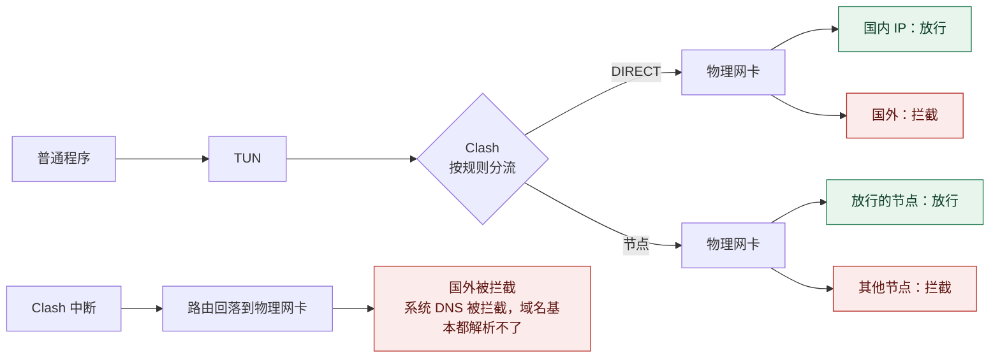
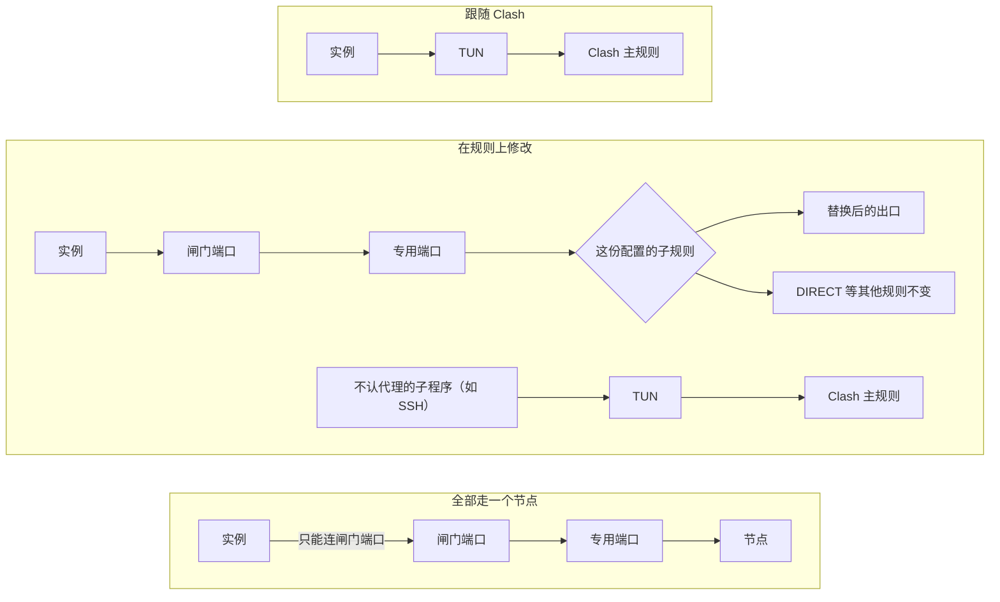
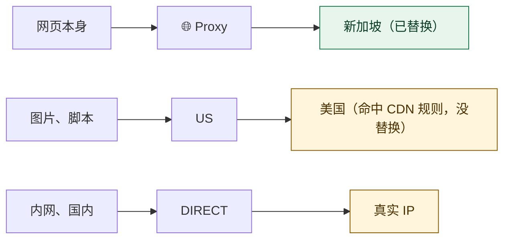

<div align="center">


# SandGate

**Clash 出问题时不漏真实 IP，让每个程序走自己的出口**

[](#快速开始)
[](#快速开始)
[](#自动同步到-clash)
[](#开发)
[](LICENSE)

[快速开始](#快速开始) · [全机防护](#全机防护) · [沙盒实例](#沙盒实例) · [常见问题](#常见问题) · [命令](#命令)

</div>

<br>

SandGate 是一个 macOS 工具，配合 Clash Verge 使用，通过网页配置。它解决两个问题：

- **Clash 出问题时不暴露真实 IP：** TUN 异常或 Clash 更新时，普通程序不会悄悄直连国外网站，也不会切到你没放行的节点。
- **让某些程序换一个出口：** 同一个程序可以开多份，各走各的 IP，同时不影响它们使用 `git`、SSH 和内网。

它由两个相互独立的部分组成，可以只用其中一个：

| | 全机防护（pf） | 沙盒实例 |
|---|---|---|
| 作用范围 | 整台 Mac 的所有程序 | 由 SandGate 启动的程序 |
| 流量怎么走 | 按 Clash 规则分流，物理网卡只能连放行的目标 | 由实例选择的网络配置决定 |
| 对程序的要求 | 无 | “跟随 Clash”无要求；其他配置要程序支持代理 |
| 节点挂了 | 走该节点的流量失败，其他不受影响 | 只影响用到这个节点的实例 |
| 需要 root | 需要 | 不需要 |

## 目录

- [快速开始](#快速开始)
- [页面说明](#页面说明)
- [全机防护](#全机防护)
- [沙盒实例](#沙盒实例)
- [常见问题](#常见问题)
- [命令](#命令)
- [文件位置](#文件位置)
- [安全](#安全)
- [尚未验证的情况](#尚未验证的情况)
- [设计记录](#设计记录)
- [开发](#开发)
- [许可证](#许可证)

## 快速开始

需要 Node 20 及以上和 Clash Verge，没有其他依赖。

> [!IMPORTANT]
> **以下命令都在普通终端里运行。** `sandbox-exec` 不能嵌套，在已经沙盒化的环境里运行时实例会以退出码 71 失败。

1. **启动 SandGate：** 装成后台服务，登录后自动运行。

   ```bash
   cd ~/sandbox
   node bin/sandgate.js service install
   node bin/sandgate.js url    # 显示带令牌的登录链接
   ```

2. **连接 Clash：** 在 Clash Verge 里开启外部控制，再到「配置」页点“从 Clash Verge 读取”。

3. **开启全机防护（可选）：** 在「配置」页填要放行的节点或组，保存后运行：

   ```bash
   sudo bash scripts/sandgate-pf.sh install
   ```

4. **新建实例：** 在「总览」点“新建实例”，默认的“跟随 Clash 规则”不用任何设置。要换出口时，先到「网络配置」页新建配置。

5. **检查：** 「环境检查」页的项目都应该通过。启动实例前，可以先运行一次“泄漏自检”。

## 页面说明

| 页面 | 用途 |
|---|---|
| **总览** | 全机防护状态、实例闸门、实例列表。实例可以按网络配置或按应用程序分组，选择保存在当前浏览器里 |
| **网络配置** | 新建和修改网络配置，手动同步到 Clash。页面上有“规则从哪来，出口怎么替换”的说明 |
| **配置** | Clash 控制接口、全机防护的放行列表、期望出口 IP、闸门检查的参数 |
| **环境检查** | 逐项检查 `sandbox-exec`、路由、Clash、IPv6、专用端口和同步状态 |

## 全机防护

物理网卡只能连四类目标：放行的节点、国内 IP、mihomo 的引导 DNS、局域网。pf 只看目标地址，不分辨是哪个程序发的包。



> [!WARNING]
> **Clash 中断时，依赖域名的程序基本都会断网，包括微信和国内网站。** 这是有意的取舍：放行系统 DNS 能让国内网站继续用，但所有访问过的域名都会以明文发给 DNS 服务器。

### 安装后的行为

`install` 把脚本复制到 `/usr/local/sbin/sandgate-pf`，并注册 root 权限的 LaunchDaemon `com.sandgate.pf`。规则放在 `com.apple/sandgate` 这个 anchor 下，不修改 `/etc/pf.conf`。

- **加载：** 服务启动时加载一次规则。开机后的前 10 分钟每 30 秒确认规则确实生效，因为 macOS 开机时也会加载 `/etc/pf.conf`，两者的先后不固定。
- **之后的 `pfctl` 调用：** 只在放行列表变化或出现新网卡时才调用，没有定时重载。
- **服务退出：** 规则保留，只是列表不再更新。崩溃后由 launchd 重启。
- **开机时读不到列表：** 使用上次校验通过的副本。
- **开机早期：** 规则加载之前有一段没有防护的时间，通常在登录和 Clash 启动之前。

想先试用可以运行 `trial`，到时间自动撤销，最长 86400 秒。`ALLOW_LAN=0` 可以取消局域网、多播和链路本地放行，安装时的设置会一直保留。

### 出问题时怎么恢复

> [!CAUTION]
> **安装后，重启不会清除规则。**

1. 能进系统就运行 `sudo /usr/local/sbin/sandgate-pf uninstall`。
2. 连续两次开机都在 10 分钟内异常结束（panic、强制关机）时，服务会自动停止加载规则，直到重新运行 `install`。这时全机防护未生效，页面会显示未生效，`status` 也会提示。正常关机不计入。
3. 崩溃发生在开机 10 分钟之后时，这个保护不会触发，要趁还能操作时手动卸载。

### 放行列表怎么更新

在「配置」页填要放行的节点或组名。SandGate 每 15 秒读取 Clash Verge 生成的配置，算出物理网卡上实际要连的 IP。pf 这边每 30 秒检查一次，列表变化时才更新。

- **组：** 展开为全部成员，订阅增删节点后自动跟随。
- **链式节点：** 带 `dialer-proxy` 的节点放行它的前置节点，不放行它自己，因为它自己的服务器只经前置节点访问。
- **实例用到的节点：** 自动放行，包括网络配置里替换的出口。
- **读取失败：** 配置无法解析或选不出节点时继续用上次的列表，页面会提示。
- **服务器写域名的节点：** 只支持 IPv4 地址的节点。写域名的节点不会放行，因而连不上，页面会提示。
- **proxy-provider：** 其中的节点读不到，页面会提示。
- **SandGate 没运行时：** 列表不再更新。订阅换了 IP 的节点会连不上，但不会泄漏。

列表文件由非 root 进程写入，root 脚本每次都严格校验：节点和 DNS 只能是单个 IP，网段前缀至少 /8，不接受保留地址，任何异常都拒绝整个文件。不过同一用户下的恶意程序仍然可以往列表里加 IP。

### 连接守卫和状态检测

- **连接守卫：** 每 2 秒检查一次 Clash 的连接。走错节点的连接会被断开，主规则变化时总览会提示“Clash 规则已变化”，Clash 不是 `rule` 模式时也会提示。
- **防护检测：** 每 60 秒从物理网卡向 Apple 的一个地址（`17.253.144.10:443`）做一次 TCP 握手，连不上时再向 `223.5.5.5:443` 做一次，据此判断防护是否生效。防护未生效时，这些握手是真实的直连。
- **限定分流只走一个节点（可选）：** 通常留空，节点范围已由放行列表限制。填写后，按 Clash 规则分流的连接只要不走这个节点也不走直连，约 2 秒内就会被断开。放行多个节点时不要填。

### 国外直连改走节点

Clash 的直连规则大多按域名判断（`domestic_non_ip`、`DOMAIN-SUFFIX,adobe.com,DIRECT` 等），不管实际 IP 在哪；pf 按 IP 判断，网卡只许连国内 IP、节点和局域网。两者对不上的连接会失败，例如小米互联服务用的 `sg-idm.api.io.mi.com` 在国内规则里，IP 却在新加坡。

在「配置」页的“国外直连改走”填一个组（例如 `🌐 Proxy`）后，SandGate 改写 Clash 的主规则：

- **每条 `DIRECT` 规则拆成两条：** 目标在 pf 允许的范围内（国内 IP 列表、局域网、“额外放行”）时仍然直连；否则改走填的组。`MATCH,DIRECT` 也一样。国内 IP 列表和 pf 用的是同一个文件。
- **回退 DNS 经这个组查询：** Clash 的 `fallback` DNS（如 `dns.google`）只在国内 DNS 给出国外 IP 时才采用，直连它们在国内本来就不通，pf 也会拦，结果这类域名解析超时。改写后的地址形如 `https://dns.google/dns-query#🌐 Proxy&sandgate=1`，已经写了 `#` 的不动。
- **不改的规则：** `AND`/`OR`/`NOT`、`SUB-RULE` 和内容里带括号的规则；你自己的 sub-rules。网络配置的 sub-rules 从改写后的主规则生成，所以“替换出口”也能替换这个组。
- **同步方式：** 和网络配置一样，写进脚本扩展并立即重载 Clash。清空这一项再保存就恢复原样。保存后总览会提示一次“Clash 规则已变化”，确认即可。

代价：这些国外服务看到的是节点 IP，流量也走节点；按域名直连的连接匹配规则时要先解析 IP（直连本来也要解析，有缓存）。回退 DNS 能用之后，每次解析都会同时经节点问一次回退服务器，这是 Clash 的 `fallback` 本来的行为。

### 全机防护的限制

- **Clash 中断时仍可以直连国内 IP。** pf 分不清发包的程序，已知 IP 或自带 DNS 的程序都能连，对方看到的是真实 IP。放行的引导 DNS 也一样能被任何程序使用。
- **规则写错就是真实直连。** 被判成 `DIRECT` 的网站看到的是你的真实 IP。
- **Clash 要保持 `rule` 模式。** 切到 `direct` 或 `global` 后不再按规则分流。
- **指向国外 IP 的 `DIRECT` 会失败。** 用[国外直连改走节点](#国外直连改走节点)让它们走节点；或者加到「额外放行」，但这类目标在 Clash 中断时也能被任何程序直连。
- **放行的节点之间不钉死。** 放行多个节点时，Clash 切换到其中任何一个都不受限制，包括 `url-test` 组的自动切换。
- **节点地址在国内 IP 表里时无法拦截。** 比如使用国内中转的节点。
- **物理网卡上的 IPv6 基本不可用。** 只保留局域网和链路本地地址，不放行节点和国内 IPv6。
- **新网卡最多有 30 秒空档。** 安装后新插入的网卡要等下一次检查才进入规则。试运行不跟随新网卡，插入后不受保护。
- **未覆盖 `en` 以外的物理接口。** 蓝牙 PAN 等不在规则内。

## 沙盒实例

实例由两部分决定：**网络配置**决定流量怎么走，**数据环境**决定文件怎么隔离。两者可以任意组合，一个网络配置可以给多个实例用。

### 网络配置

| 配置 | 流量怎么走 | `git`、SSH、内网 | 程序要支持代理吗 | 出口由谁保证 |
|---|---|---|---|---|
| **跟随 Clash 规则**（默认） | 和普通程序一样按 Clash 规则分流 | 正常 | 不用 | Clash |
| **在 Clash 规则上修改** | 以 Clash 规则为基础，替换指定的出口，可加额外规则 | 见下方说明 | 要 | Clash |
| **全部走一个节点** | 所有流量都走这个节点 | 不认代理的程序连不上 | 要 | 系统强制 |
| **完全禁网** | 不能联网 | 不可用 | 不适用 | 系统强制 |



**怎么选：**

- **只想隔离文件，网络照常：** 跟随 Clash 规则。
- **想换 IP，同时 `git`、SSH、内网都正常：** 在 Clash 规则上修改。
- **绝不能走错出口：** 全部走一个节点。不认代理的程序会连不上，但不会走错路。

**“在规则上修改”要注意：**

- **`DIRECT` 规则走真实 IP。** 这样内网和国内服务才能正常用，但这些网站看到的是真实 IP。
- **子程序看是否认代理。** `git`（HTTPS）、`curl` 继承代理变量，走这份规则；SSH 不认代理，走 Clash 主规则。
- **不由系统强制。** 程序不走代理时，流量走 Clash 主规则，不会被拦住。
- **出口不存在时拒绝连接。** 订阅删掉了某个节点或策略组时，用到它的流量会被拒绝，不会让 Clash 配置失效，也不会走别的出口。页面会提示。

不支持代理的程序目前只能选“跟随 Clash 规则”，没法单独换出口。

### 规则从哪来，谁优先

基础规则就是 Clash Verge 合成后的主规则，包括你在 Clash Verge「编辑规则」页改的规则和订阅自带的规则。Clash Verge 先合成规则，再运行脚本扩展，所以 SandGate 拿到的已经是合成结果。

实例从上到下匹配，先命中的生效：

1. **SandGate 配置的额外规则：** 只影响用这个配置的实例。
2. **Clash Verge「编辑规则」页的规则：** 影响所有流量，存在规则文件里，订阅更新不会覆盖。
3. **订阅自带的规则：** 影响所有流量，随订阅更新。

| 你想要的效果 | 写在哪 |
|---|---|
| 所有程序都这样走 | Clash Verge 的「编辑规则」页 |
| 只有某个配置的实例这样走 | SandGate 配置的额外规则 |
| 换掉某个配置的出口，规则本身不变 | SandGate 配置的替换出口 |

额外规则的格式是 `类型,内容,策略`，比如 `DOMAIN-SUFFIX,corp.example.com,DIRECT`。不支持 `MATCH`、`SUB-RULE` 和 `AND` 这类组合规则。

在 Clash Verge 里改规则后，它重新生成配置时实例的子规则也会更新，不用在 SandGate 里同步。总览可能提示“Clash 规则已变化”，确认是你改的就行。

### 替换出口只改你选的组

替换按策略组进行，规则指向哪个组，就只有替换了那个组才会变。一个网页的流量可能分几路走，比如只把 `🌐 Proxy` 换成新加坡时：



CDN 规则是专门给静态资源域名（图片、视频、脚本、安装包）指定出口的规则集，比如 `cdn_domainset`、`cdn_non_ip`。如果它们指向 `US` 组，只换 `🌐 Proxy` 时这部分仍走美国。

- **只想让主要流量换 IP：** 替换 `🌐 Proxy` 就够了。
- **想让代理流量都从同一个地区出去：** 把规则用到的组都替换掉，比如 `US`、`🤖 AI`、`🎬 Streaming`。编辑配置时页面会列出每个组和它的规则数。
- **所有流量都走同一个 IP：** 选“全部走一个节点”，这样 `DIRECT` 也不例外。

### 自动同步到 Clash

不用手动改 Clash 配置。保存网络配置时，SandGate 做两件事：

1. **更新脚本扩展：** 在当前 Clash Verge 配置的脚本扩展里维护一个带标记的区块。Clash Verge 每次生成配置时，区块读取当时的规则生成子规则，所以规则变了也会自动跟上。第一次修改前会备份到 `~/.sandgate/backups/`。
2. **重载 Clash：** 通过控制接口把新配置加载进运行中的 Clash，通常不断开已有连接。配置有问题时 Clash 会拒绝加载，继续用原来的配置。

| 操作 | 会重载 Clash 吗 |
|---|---|
| 用已有配置新增、删除实例 | 不会 |
| 新建、修改、删除网络配置 | 会，自动进行 |
| 更新订阅、在 Clash Verge 里改规则 | Clash Verge 自己重新生成配置 |

- **修改配置后：** 用它的实例的现有连接会断开，新连接走新规则。
- **换了 Clash Verge 的订阅配置：** 新配置的脚本扩展里没有这个区块。SandGate 启动时发现端口未监听会自动同步，也可以在「网络配置」页手动同步。
- **怎么确认脚本扩展有效：** 看「环境检查」的“Clash Verge 生成的配置”。只有 Clash Verge 能运行脚本扩展，SandGate 只能检查它生成的结果：
  - **已包含：** 脚本扩展有效。
  - **下次生成时会带上：** 配置已经生效，只是 Clash Verge 还没重新生成过配置，不用处理。更新订阅或重载后就会变成“已包含”。
  - **脚本扩展里没有：** 比如换了订阅配置，到「网络配置」页点“同步到 Clash”。
  - **生成了却没有：** 脚本扩展可能没有生效，要检查它是否启用。

SandGate 也会接管配置里名字以 `sandgate-` 或 `sgp-` 开头的端口和子规则，其他内容不动。

### 闸门

用到专用端口的实例都经过闸门。每个专用端口有独立的闸门，关闭时会断开它的现有连接，并拒绝新连接。

| 情况 | 闸门 |
|---|---|
| 节点挂了、延迟测试失败 | **不关**，页面显示警告。端口只会返回 502，不会退回直连，所以不会暴露 IP，节点恢复后连接马上恢复 |
| 查到流量走了别的节点或直连 | 关。只有“全部走一个节点”有这项检查，默认每 15 秒一次，同时连接守卫约 2 秒内断开走错节点的连接 |
| 出口 IP 和设定的不一致 | 关。只有“全部走一个节点”并在「配置」页填了期望出口才检查，默认每 30 秒一次 |
| 修改规则的配置：Clash 不是 rule 模式、开了 IPv6，或替换的出口在 Clash 里没了 | 关，每 2 秒检查一次。和 claude-guard 原来的检查相同，见[终端命令](#终端命令) |
| TUN 异常、专用端口没了 | 关，恢复后稳定 3 秒再开 |
| 电脑睡眠唤醒 | 不关，唤醒后所有检查立刻重跑 |
| 点“断开所有实例” | 全部关，解除后恢复 |

第一次打开前，“全部走一个节点”的闸门必须确认过一次流量走对了节点；如果这时节点正好挂着，闸门会等节点恢复。配置页可以调整这些检查的开关和间隔，“节点不可用时也关闭闸门”默认关闭，通常不用开。

“全部走一个节点”的保证如下，任何一环出问题，结果都是连接失败：

| 环节 | 保证 |
|---|---|
| `sandbox-exec` | 只能连自己的闸门端口，其余网络操作被拒，包括 DNS。规则由内核执行 |
| 闸门端口 | 只会连该节点的专用端口，代码里没有其他出路。SandGate 退出后端口消失 |
| 专用端口 | 只走这个节点，节点挂了连接失败，不会切换 |
| 钉死检查 | 定期查询探测连接实际走的节点，不对就关闸门 |

### 数据环境

新建实例时二选一：

| | 独立数据（分身） | 共用数据（只隔离网络） |
|---|---|---|
| `HOME` | 实例目录 `~/.sandgate-instances/<id>` | 你的用户目录 |
| 能否访问你的用户目录 | 默认不能，只有实例目录、工作目录和共享文件夹可以；勾选“分身也能读写你的用户目录”后可以 | 能，和直接打开程序一样 |
| 钥匙串工具 `/usr/bin/security` | 不能运行，见下文 | 不能运行，见下文 |
| 配置、缓存、登录状态 | 存在实例目录 | 存在原来的位置 |
| 受保护目录（`.aws`、`.gnupg`、钥匙串等） | 不可访问 | 不可访问 |
| 其他实例的目录 | 不可访问 | 不可访问 |

> [!CAUTION]
> **删除实例时，实例目录会一起删除，无法恢复。**

实例停止时可以点“清空数据”：只删除实例目录里的内容，实例的设置保留，下次启动就像第一次打开。共用数据模式下，程序放在你用户目录里的数据不受影响。

参数和环境变量里可以用这些变量：

| 变量 | 含义 |
|---|---|
| `{port}` | 闸门端口。“跟随 Clash”的实例没有端口，含 `{port}` 的参数会被去掉 |
| `{data}` | 实例目录，两种数据环境下都可用 |
| `{home}` | 程序的用户目录 |

勾选“分身也能读写你的用户目录”后，`HOME` 仍是实例目录，所以程序的账号、设置和记录仍和主环境分开，但能读写你的项目。这时实例会自动设置 `GIT_CONFIG_GLOBAL=~/.gitconfig`，git 提交仍用你的身份；在环境变量里自己设置的值优先。

共用数据模式和能读写用户目录的分身，还可以填“和主环境共用的路径”（相对用户目录，每行一个）。每次启动时，实例目录里的这些路径会换成指向你用户目录同一位置的链接，所以两边用的是同一份。实例里原来就有的内容不会丢：目录会并进你那边，两边都有的同名文件，实例那份改名为 `<名称>.from-<实例 id>`；文件在你那边没有时搬过去，有的话用你的那份，实例原来的留作 `<名称>.sandgate-bak`。两边都还没有的路径先不链接，等程序建出来以后，下次启动再链接。

Claude Code 预设默认共用这些路径：

| 路径 | 内容 | 为什么共用 |
|---|---|---|
| `.claude/projects` | 会话记录，以及每个项目的自动记忆（`memory/`） | CloudCLI 的会话列表和恢复会话读这里；换账号后记忆还在 |
| `.claude/sessions` | 正在运行的会话 | CloudCLI 靠它判断会话是在后台运行（用 attach）还是要恢复 |
| `.claude/file-history`、`.claude/tasks`、`.claude/session-env` | 会话的检查点、任务列表和环境 | 在另一个实例里恢复会话时也能用 |
| `.claude/history.jsonl` | 输入过的提示词 | 按 ↑ 能翻到 |
| `.claude/settings.json`、`.claude/CLAUDE.md`、`.claude/skills`、`.claude/agents`、`.claude/commands`、`.claude/plugins` | 你的设置、全局指令和扩展 | 和账号无关 |
| `.claude/ide` | 编辑器写的连接信息 | 分身也能连上 VS Code 等编辑器 |

不共用的是账号自己的东西：登录（`.claude/.credentials.json`）、`~/.claude.json`（账号信息、各项目的信任记录、MCP 服务器配置）、缓存和统计。临时目录也不共用：分身的 `TMPDIR` 是实例目录里的 `tmp/`，里面只是命令输出这类临时文件。

套沙盒的实例都不能用钥匙串：钥匙串目录受保护，而且钥匙串按用户划分，实例不可能有自己的一份。所以实例里 `/usr/bin/security` 也不能运行，`PATH` 最前面换成 SandGate 自带的替身 `libexec/no-keychain/security`：查询一律回答“找不到”（退出码 44），修改一律失败（退出码 1）。用这个工具保存登录的程序（比如 Claude Code）会因此把登录存在文件里（分身是它的 `HOME` 下，共用数据模式下是程序配置目录里，比如 `CLAUDE_CONFIG_DIR`）。Claude Code 只接受“成功”“找不到”“钥匙串已锁定”这几种回答，工具无法运行或返回其他错误时，它会放弃保存登录，提示 “Couldn't save your login”。所以只禁止运行真正的工具不够，必须有这个替身。

`~/.ssh` 不受保护，所有实例里的 ssh 都能读到 `config`、`known_hosts` 和私钥，可以照常连服务器；看不到用户目录的分身也单独放行了它，因为 ssh 按系统用户记录找 `~/.ssh`，不看 `HOME`。代价是沙盒里的程序也能读到私钥。

需要钥匙串的实例可以在设置里打开“允许使用钥匙串”（默认关闭）。打开后，这个实例不再禁止访问 `~/Library/Keychains`，也不用替身，git 的 `osxkeychain`、`gh` 等都能取到你存的密码和令牌。代价是沙盒里的程序能读到钥匙串里所有不需要你确认的条目，和不套沙盒时一样。Claude Code 设了 `CLAUDE_CONFIG_DIR` 时，它在钥匙串里的条目名是 `Claude Code-credentials-<目录路径 sha256 的前 8 位>`，每个实例一条，不会和主环境不带后缀的那条混用（Claude Code 2.1.319 的代码里是这样算的）。原来存在文件里的登录，下次写入时会搬进钥匙串，不用重新登录。只在共用数据模式下用过；分身改了 `HOME`，钥匙串是否正常没有测过。

分身的限制：

- **应用设置不隔离。** 通过系统偏好设置服务（`NSUserDefaults`、`defaults`）保存的设置由沙盒外的 `cfprefsd` 写入，仍然落在真实的 `~/Library/Preferences`，同一程序的分身之间、分身和主环境之间共用。Chrome 的设置在它的数据目录里，不受影响。
- **系统临时目录只是不能列出。** 实例的 `TMPDIR` 指向实例目录，但有些程序不认它，比如 Chrome 的单实例锁，所以系统临时目录没有封死。知道文件名时仍然能打开，`/tmp` 也是共用的。
- **系统权限共用。** 摄像头、麦克风等授权按应用记录，所有分身共用一份。
- **共享文件夹最好不放在下载、文稿、桌面里。** 这些位置受 macOS 隐私权限保护，可能弹出授权提示。放在用户目录下的普通文件夹最省事。
- **App Store 应用和自带沙盒的应用很可能跑不起来。** 它们的数据在系统管理的 `~/Library/Containers`，而且沙盒不能嵌套。这一点是推断，没有逐个测试。
- **不等于虚拟机。** 分身和你用的是同一个 macOS 用户，共用内核和系统服务。

### 不套沙盒

新建实例时可以勾选“不套沙盒”，默认关闭。这时程序直接运行，不经过 `sandbox-exec`。

| | 默认（套沙盒） | 不套沙盒 |
|---|---|---|
| Chrome 自带沙盒 | 关闭（`--no-sandbox`） | **保留** |
| 钥匙串 | 不能用 | **能用** |
| `--no-sandbox` 警告条 | 有 | **没有** |
| 单独选出口、多开 | 可以 | 可以 |
| 读写你的文件 | 分身模式下不能 | **能** |
| 绕过代理的流量 | “全部走一个节点”时被系统拦住 | **拦不住**，走 Clash 主规则 |
| 完全禁网 | 可以 | 不支持，保存时会拒绝 |
| `HOME` | 看数据环境 | 你的用户目录 |

- **自动去掉的参数：** 启动时去掉 `--no-sandbox` 和 `--use-mock-keychain`，否则 Chrome 自带的保护也没了，一层都不剩。
- **数据目录：** 仍然可以用 `{data}`，Chrome 预设的 `--user-data-dir={data}/profile` 不变，Cookie 和登录状态也在这里，和主 Chrome 分开。删除实例或“清空数据”时一起删除。
- **切换这个选项会丢失 Chrome 的登录状态：** 实测切换后 Cookie 读不出来，切回去也一样。两种方式的 Cookie 加密密钥不同，所以最好在第一次登录前就选好。已经登录过的，可以先停止实例、点“清空数据”，切换后重新登录。
- **“全部走一个节点”：** 只靠程序的代理设置，不再有系统强制的保证。
- **泄漏自检：** 没有沙盒就没有越权操作可测，只检查闸门。

**适合** Chrome 这类自带沙盒、要登录账号的程序。**不适合**不信任的程序，以及没有自带隔离的程序：Electron 应用的扩展和终端、命令行工具都有你的全部用户权限。

### 时区

新建实例默认用 `America/Los_Angeles`，可以在新建或编辑时修改，留空跟随系统，下次启动实例生效。网站能看到时区，和出口所在地不一致时可能成为识别特征。

它通过环境变量 `TZ` 生效，手动写的 `TZ` 环境变量优先。网络配置里的默认时区只在页面上选择配置时带入实例，之后改配置不会同步到已有实例。

**看日志时要注意，不同来源的时间不是同一个时区：**

| 来源 | 时区 | 例子 |
|---|---|---|
| 实例日志里程序自己输出的时间 | 实例的时区 | 默认是洛杉矶时间 |
| 实例日志里 SandGate 写的启动记录 | UTC | `=== 2026-11-05T04:22:09.574Z start ... ===`，末尾的 `Z` 表示 UTC |
| `~/.sandgate/logs/daemon.log` 的闸门记录 | 本机时区 | `2026/11/5 19:06:44 闸门关闭 ...` |
| `/var/log/sandgate-pf.log` | 本机时区 | `2026-11-05 11:56:30 规则已加载 ...` |

### 程序预设和多开

点实例的“使用相同配置新建实例”，会打开填好原实例设置的新建对话框，可以改一下再保存，比如换一个网络配置。新实例有自己的实例目录和闸门端口，**不会复制原实例的数据**，登录状态、Cookie 都要重新来。要在同一个实例里多开窗口，直接在程序里操作即可。

- **命令行程序：** 通常直接可用，默认禁止通过系统服务联网或拉起其他 App。
- **Chromium / Electron：** 用预设最可靠，已实测 Chrome 和 VS Code 的“跟随 Clash”和“修改规则”两种模式，Chrome 还测过“全部走一个节点”。VS Code 建议再加 `--extensions-dir={data}/ext`，让扩展也放在实例目录。
- **原生 GUI 应用：** 取决于应用本身。有些应用不认 `HOME`，或有自己的单实例检测，需要实测。

Chromium 预设包含这些参数：

| 参数 | 作用 |
|---|---|
| `--proxy-server=socks5://127.0.0.1:{port}` | 走闸门端口，“跟随 Clash”时自动去掉 |
| `--user-data-dir={data}/profile` | 独立的浏览器数据。共用数据模式也需要，否则窗口会并入已在运行的 Chrome，不走选定的出口 |
| `--no-sandbox` | Chrome 自带的沙盒不能套在 SandGate 的沙盒里，去掉后 Chrome 启动就退出 |
| `--use-mock-keychain` | 实例不能用钥匙串，否则启动时弹出“找不到钥匙串” |
| `--no-first-run`、`--no-default-browser-check` | 跳过首次运行提示 |
| `--lang=en-US` | 浏览器语言 |
| `--force-webrtc-ip-handling-policy=disable_non_proxied_udp` | 禁止 WebRTC 绕过代理 |

### 终端命令

在实例设置里填“终端命令”（比如 `claude`），再运行一次：

```bash
node bin/sandgate.js alias install
```

它在 `~/.zshrc` 末尾加入一段带标记的代码，加载 `~/.sandgate/aliases.zsh`。之后在终端输入 `claude`，就会在当前终端里启动这个实例：用当前目录和你输入的参数，保留终端的输入输出、Ctrl-C 和退出码，可以同时开多个。`alias uninstall` 移除这段代码，原来同名的别名会恢复生效。

每个终端命令还有一个固定的可执行文件 `~/.sandgate/bin/<命令>`，别名就是调用它。需要填 claude 路径的程序（比如 CloudCLI 的 `CLAUDE_CLI_PATH`）也填这个路径，这样终端和这些程序走同一个实例。

**一个终端命令同一时间只指向一个实例。** 切换账号就是把命令改到另一个实例上，有三种做法：

- 给另一个实例填同样的终端命令，保存时会问是否改过来。
- 在同一程序的其他实例卡片上点“终端 claude 改用这个”。
- 在终端运行 `node bin/sandgate.js alias use <实例名称的一部分或 ID>`。

别名和可执行文件里写的是命令名，启动时才去查它指向哪个实例，所以改指向后，已经打开的终端也立刻生效，`~/.zshrc` 和 `CLAUDE_CLI_PATH` 都不用改。已经在运行的会话留在原来的实例里。新加的命令名要新开终端才有别名。

- **SandGate 没在运行时不能启动。** 终端会显示原因，退出码 78。
- **闸门关着时也能启动**，但闸门打开前连不上网，终端里会有提示。
- **从终端启动的实例不显示为“运行中”**，因为 SandGate 不是它的父进程。设了终端命令的实例，闸门端口会在 SandGate 运行期间一直开着。
- **看不到用户目录的分身**会放行启动时所在的目录。如果这个目录是用户目录本身或它的上级，则不放行，以免整个用户目录都暴露出来。

**用分身运行 Claude Code（预设“Claude Code（在终端里运行）”）：** 用“修改规则”的网络配置，把 AI 组的出口换成固定节点，比如“AI走新加坡”。这样 Claude 的流量走这个节点，git、npm 等照 Clash 规则走。

修改规则的配置都会做 claude-guard 原来的检查，任何一项不通过就断网：

| 检查 | 间隔 |
|---|---|
| Clash 是 rule 模式、IPv6 关闭 | 2 秒 |
| TUN 开启、默认路由走 TUN | 1–2 秒 |
| 替换的出口在 Clash 里还存在 | 2 秒 |

这些检查只问本机的 Clash，不对外发请求。claude-guard 还检查 AI 组当前选的是不是选定节点，这里不需要：这份配置直接把 AI 组的出口换成了节点，不受组里当前选择影响。（claude-guard 的这项检查实际上一直没生效：它记的组名是 `AI`，Clash 里叫 `🤖 AI`，找不到组就跳过了。）

**实际出口不定时检查，需要时在「网络配置」页点“检查出口”。** 它经这份配置的入口访问 `api.anthropic.com` 和 `claude.ai` 的 `/cdn-cgi/trace` 页面，显示各自的出口 IP 和国家（国家由 Cloudflare 根据 IP 判断）。适合在改了规则、订阅更新或换了节点之后看一眼。不定时检查的原因：真实 IP 不会漏，由全机防护保证；AI 组的出口由这份配置固定；而每次检查都是从你账号的出口向对方发一次请求。只有两种情况上面的检查发现不了：`api.anthropic.com` 不再命中 AI 规则；节点名字没变，服务器换到了别的国家。

预设用共用数据模式，所以 `HOME` 就是你的用户目录，Claude 里的 `~` 和命令行里的一样。环境变量设 `CLAUDE_CONFIG_DIR={data}/.claude`，Claude Code 的 `.claude`、`.claude.json` 和登录都放进实例目录 `~/.sandgate-instances/<id>/.claude`（登录文件权限 600，其他实例读不到），所以每个实例可以登录不同账号；会话记录、记忆等通过上面的共用路径和你共用一份。预设默认打开了“允许使用钥匙串”，所以 Claude 里能用 git 推送和 `gh`，登录也存在钥匙串里这个实例自己的条目。另外还设了 `BROWSER=/usr/bin/false`（登录时只显示链接，不打开浏览器）和 `DISABLE_AUTOUPDATER=1`（更新用主环境的 `claude update`）。

### 泄漏自检

“泄漏自检”在实例的沙盒里实际尝试越权操作，检查结果取决于网络配置：

| 检查项 | 全部走一个节点、完全禁网 | 跟随或修改 Clash 规则 |
|---|---|---|
| 沙盒配置能否加载 | 检查 | 检查 |
| 读取 SandGate 令牌、列出其他实例的目录 | 应被拦截 | 应被拦截 |
| 读写真实用户目录（仅看不到用户目录的分身） | 应被拦截 | 应被拦截 |
| 运行钥匙串工具（仅分身） | 应被拦截 | 应被拦截 |
| 直连公网 IP 和域名、UDP、`nscurl` | 应被拦截 | 不检查，这两种配置本来就能直接联网 |
| 绕过闸门直连专用端口 | 应被拦截 | 不检查 |
| 经闸门访问 | 闸门开时应成功，关时应失败；完全禁网不检查 | 修改规则时同左；跟随 Clash 不检查 |

### 沙盒实例的限制

- **全部走一个节点时必须支持代理。** 不读取 `HTTP_PROXY` / `ALL_PROXY`，也没有 `--proxy-server` 这类参数的程序会一直断网。只认系统代理的原生应用属于这一类。
- **全部走一个节点时没有 UDP，也没有分流。** QUIC 等 UDP 流量被拒绝，多数应用会回落到 TCP；国内网站也走这个节点。
- **跟随或修改 Clash 规则时，实例可以直接联网。** 这时沙盒只隔离文件，走哪个出口由 Clash 决定。
- **系统服务可能是漏点。** 应用可能通过 XPC 请求沙盒外的系统服务联网。配置拦截了已知的几个，但无法保证覆盖全部。
- **默认不能用钥匙串。** `~/Library/Keychains` 被禁止访问，实例里还不能运行 `/usr/bin/security`，需要时在实例设置里打开“允许使用钥匙串”。Chrome 加了 `--use-mock-keychain` 后能正常保持登录；Claude Code 会改为把登录存在实例目录的文件里。其他直接依赖钥匙串保存登录状态的应用可能无法登录。
- **Chrome 实例的安全性比普通 Chrome 低。** `--no-sandbox` 减弱了网页和浏览器之间的隔离。`--use-mock-keychain` 不影响保持登录，实测重启后带有效期的 Cookie 还在，但它用的是固定密钥，能读到这个文件的程序就能解开。这类实例不建议登录重要账号，也不建议打开不信任的网站。
- **Chrome 会在实例目录里安装更新程序。** 它把 `GoogleUpdater` 和对应的 LaunchAgent 文件写进实例目录。如果系统里没有同名任务，它可能被注册到沙盒之外运行。
- **`sandbox-exec` 已被 Apple 标记为弃用。** 目前可用，但没有长期保证。

## 常见问题

| 现象 | 原因和处理 |
|---|---|
| 退出 Clash 后，微信和国内网站也上不了网 | 全机防护拦了系统 DNS，这是有意的取舍。重新打开 Clash 即可 |
| 所有程序都断网，想马上恢复 | `sudo /usr/local/sbin/sandgate-pf uninstall` |
| 总览提示“全机防护未生效” | 先看 `sudo /usr/local/sbin/sandgate-pf status`。显示异常重启保护已触发时，确认系统稳定后重新运行 `install` |
| 总览提示“Clash 规则已变化” | 更新订阅或改规则后的正常提示，确认是你改的就点“确认无误” |
| 总览提示 Clash 是 `direct` 或 `global` 模式 | 在 Clash Verge 里切回“规则”模式 |
| 某个国外服务连不上，或国内软件的某个功能不能用 | 可能命中了 `DIRECT` 规则而被 pf 拦住，Clash 日志里会有 `dial DIRECT ... dns resolve failed` 或连接超时。打开[国外直连改走节点](#国外直连改走节点)，或者把它的 IP 加到「配置」页的“额外放行” |
| 闸门显示“端口未监听” | 到「网络配置」页点“同步到 Clash” |
| 实例刚启动的几秒连不上 | 配置的第一个实例启动时，闸门要等检查通过并稳定 3 秒才开，实际约 5 秒 |
| 实例网页的出口有的对、有的不对 | 看[替换出口只改你选的组](#替换出口只改你选的组)，通常是 CDN 规则指向了没替换的组 |
| 改了出口，已经打开的下载还走旧节点 | 修改配置时会断开经闸门的现有连接。程序绕过代理的连接不受影响 |
| 同步失败或提示“改动会丢失” | 当前 Clash Verge 配置没有脚本扩展，或者脚本里找不到 `return config`。给它启用脚本扩展后再同步 |
| 弹窗“a keychain cannot be found” | 点 **Cancel，不要点 Reset To Defaults**。给这个实例加上 `--use-mock-keychain` |
| Chrome 提示 `--no-sandbox` 不受支持 | 正常现象，点 × 关闭。这是真实的风险提示，见上面的限制 |
| 实例日志里的时间对不上 | 程序输出的时间用实例的时区（默认洛杉矶），SandGate 写的启动记录用 UTC，见[时区](#时区) |
| 实例退出码 71 | SandGate 运行在另一层沙盒里。从普通终端或后台服务启动 |
| 实例退出码 21（Chrome） | Chrome 建不了单实例锁，通常是数据目录或临时目录不可用。先用预设参数 |
| 实例很卡、帧率很低 | 后台服务要用 `ProcessType: Interactive`，实例会继承这个级别。用当前版本重新运行 `service install` |
| 换了 Node 版本后服务起不来 | plist 记录的是安装时的 Node 路径，重新运行 `service install` |
| SandGate 重启时实例断网几秒 | 实例不会退出。走闸门端口的实例现有连接会断开，约 5 秒后恢复；“跟随 Clash”的实例不受影响 |
| 重启后实例显示“已退出”，没有退出码 | 这个实例是重启后接管的，它不是新进程的子进程，所以拿不到退出码。需要时看实例日志 |

闸门的开关和原因记录在 `~/.sandgate/logs/daemon.log`，pf 服务的日志在 `/var/log/sandgate-pf.log`。

## 命令

```bash
# SandGate 服务（不需要 root，也不会加载 pf 规则）
node bin/sandgate.js                    # 在当前终端运行
node bin/sandgate.js url                # 显示登录链接
node bin/sandgate.js service install    # 安装或更新后台服务，登录后自动运行
node bin/sandgate.js service status     # 查看后台服务状态
node bin/sandgate.js service uninstall  # 移除后台服务，配置和数据保留
node bin/sandgate.js alias install      # 让 ~/.zshrc 加载实例的终端命令
node bin/sandgate.js alias uninstall    # 从 ~/.zshrc 移除，原来的别名恢复生效
node bin/sandgate.js alias show         # 显示每个终端命令指向哪个实例
node bin/sandgate.js alias use <实例> [命令]  # 把终端命令改为指向这个实例，用来切换账号
bin/sandgate-run <实例 ID 或终端命令> [参数...]  # 在当前终端运行实例，别名就是调用它

# 全机防护（从项目目录运行）
sudo bash scripts/sandgate-pf.sh install     # 安装或更新：立即生效，之后每次开机自动加载
sudo bash scripts/sandgate-pf.sh status      # 查看状态
sudo bash scripts/sandgate-pf.sh uninstall   # 撤销，也是紧急恢复
sudo bash scripts/sandgate-pf.sh trial 1800  # 临时试用，到时自动撤销，最长 86400 秒
bash scripts/sandgate-pf.sh render           # 只打印规则，不需要 root
bash scripts/sandgate-pf.sh check <目录>     # 校验放行列表文件，不需要 root

# 安装后也可以直接用
sudo /usr/local/sbin/sandgate-pf status
sudo /usr/local/sbin/sandgate-pf uninstall
```

后台服务是用户级的 LaunchAgent，只在崩溃后自动重启。安装后 macOS 可能提示新增了后台项目，可以在「系统设置 > 通用 > 登录项与扩展」里管理。

> [!NOTE]
> **重启 SandGate 不会终止实例。** 实例继续运行，新进程启动后核对进程号和启动时间，再重新接管。走闸门端口的实例在重启期间连不上，但只会连不上，不会走错出口。这几种情况才会停止实例：在页面上点“停止”、运行 `service uninstall`、在终端里按 Ctrl-C 退出前台运行的 SandGate。

页面文件和网络配置的修改不需要重启 SandGate。只有 `src/` 下的代码更新才需要：

```bash
launchctl kickstart -k "gui/$(id -u)/com.sandgate.daemon"
```

配置项：环境变量 `SANDGATE_HOME` 可更改数据目录，实例目录会放在它旁边的 `<目录>-instances`。配置文件里的 `uiPort` 可更改网页端口，默认 7878。

## 文件位置

| 路径 | 内容 |
|---|---|
| `~/.sandgate/config.json` | 配置，包括 Clash 密钥（明文） |
| `~/.sandgate/token` | 网页登录令牌 |
| `~/.sandgate/logs/` | `daemon.log` 是服务日志，`<实例 id>.log` 是实例日志，超过 10 MB 时旧内容移到 `.old` |
| `~/.sandgate/runs.json` | 运行中的实例，重启后据此接管 |
| `~/.sandgate/aliases.zsh` | 实例的终端命令，由 SandGate 生成 |
| `~/.sandgate/bin/<命令>` | 每个终端命令的可执行文件，由 SandGate 生成 |
| `~/.zshrc` 里 `# >>> sandgate >>>` 之间的内容 | 加载上面的文件，`alias install` 写入，修改前备份为 `~/.zshrc.sandgate-bak` |
| `~/.sandgate/profiles/` | 每个实例生成的沙盒配置（`.sb`） |
| `~/.sandgate/pf/` | 给 pf 用的放行列表 |
| `~/.sandgate/backups/` | 脚本扩展修改前的备份 |
| `~/.sandgate-instances/<id>/` | 实例目录，删除实例或“清空数据”时删除 |
| `~/Library/LaunchAgents/com.sandgate.daemon.plist` | 后台服务 |
| `/Library/LaunchDaemons/com.sandgate.pf.plist` | pf 服务 |
| `/usr/local/sbin/sandgate-pf` | 安装后的 pf 脚本 |
| `/usr/local/etc/sandgate-pf.env` | pf 服务的设置 |
| `/var/db/sandgate-pf/` | 上次校验通过的放行列表和异常重启计数 |
| `/var/log/sandgate-pf.log` | pf 服务日志 |

SandGate 还会修改 Clash Verge 当前配置的脚本扩展（`profiles/` 下的 `.js` 文件），只改带标记的区块。

## 安全

- **登录令牌很重要：** 网页只监听 `127.0.0.1`，但能登录就等于能以你的身份运行任意命令，请保管好 `~/.sandgate/token`。终端命令用这个令牌直接调用接口（`Authorization: Bearer`），实例读不到它。
- **网页改不了 pf：** 网页不以 root 运行，pf 规则只能通过 sudo 执行脚本来更改。
- **防跨站：** 校验 Host 和 Origin，防御 DNS rebinding 和 CSRF。
- **密钥：** Clash 密钥明文存放在 `~/.sandgate`（权限 0700），API 不会返回它。
- **实例隔离：** 实例无法读写 `~/.sandgate`、Clash Verge 配置目录、`~/.aws`、`~/.gnupg`、钥匙串目录（可以按实例打开）和其他实例的目录；`~/.ssh` 可以读写，ssh 才能连服务器，看不到用户目录的分身（默认）连整个用户目录都不可见。
- **Clash 控制接口：** “全部走一个节点”的实例只能连自己的闸门端口，连不上 Clash 的 TCP 控制端口。“跟随”和“修改规则”的实例可以连本机端口，包括这个控制端口，靠密钥保护。
- **Clash 的 Unix socket：** 只有在「配置」页把控制接口设成 Unix socket 时，沙盒才会封掉它。设成 TCP 时，Clash Verge 配置里的 `verge-mihomo.sock` 不在封禁范围，开了 Unix socket 的实例（如 Chrome 预设）在这个文件存在时可能连上。

## 尚未验证的情况

这些情况还没有在真实环境里跑过，遇到时请留意：

- **真实节点断线：** 闸门逻辑只用临时 mihomo 和自动测试验证过。
- **睡眠唤醒后闸门不关：** 只用自动测试验证过。
- **全机防护长期运行：** 已通过 6 小时试运行和重启测试，更长时间、高负载下还要观察。
- **pf 运行时更新订阅、切换 Wi-Fi：** 没有专门测过。规则集自动更新已确认正常。
- **在 Clash Verge 里改规则后实例自动跟上：** 重载时的生成结果已验证，实际改一条规则没有测过。
- **物理网卡上的公网 IPv6：** 测试时网卡没有公网 IPv6，“已拦截”是根据 pf 规则得出的。
- **终端命令：** 别名、启动脚本和接口有自动测试，但用真实沙盒在终端里跑 Claude Code、在分身里登录并重启后保持登录，都还没有实测。钥匙串工具不能运行时 Claude Code 改读文件里的登录，只在沙盒外模拟过。
- **走 `DIRECT` 的国外服务：** Apple、Adobe、Microsoft 等是否受影响没有逐个测过。国外直连改走节点的规则和 DNS 改写已用真实 mihomo 验证，在真实 Clash 上长期运行还没有观察过。

## 设计记录

### 2026-11-04 的内核死锁

> [!CAUTION]
> 早期版本用 `user root` 放行 Clash 核心，导致了内核死锁和 panic。**任何 pf 规则都不能使用 `user` 或 `group`，脚本在加载前也会检查。**

<details>
<summary>死锁是怎么形成的</summary>

在 macOS 上，这类规则让发包路径调用 `pf_socket_lookup`，在持有其他锁时阻塞等待 TCP 的 pcbinfo 锁。panic 快照里的循环等待如下：

- 内核线程 `4587` 持有读写锁 `0xfffffe000c67eb30`，等待线程 `17878` 持有的互斥锁。
- `verge-mihomo` 的线程 `17878` 持有 pf 的互斥锁，正从 pf 规则路径等待读写锁 `0xfffffe000c67eb30`。

随后所有联网进程都堵在后面，`configd` 180 秒无响应，看门狗触发 panic。死锁约在 panic 前 593 秒形成，`pfctl` 是之后才被堵住的，定时重载不是起因。这是偶发的时序问题，短时间试运行通过不代表安全。

锁的身份由调用栈形状和 xnu 开源代码对照得出，内核文件没有这些内部函数的符号。

</details>

### 为什么这样设计

- **pf 按目标地址过滤：** 按用户过滤会触发上面的死锁，所以只看目标地址。代价是分不清发包的程序。
- **节点挂了不关闸门：** 实测 mihomo 专用端口对已挂或不存在的节点返回 502，不会退回直连，所以关闸门只会拖慢恢复。
- **未知出口变成 `REJECT`：** 规则里有一个未知策略，mihomo 就会拒绝整份配置，而订阅随时可能删节点。改成 `REJECT` 后，连接明确失败，既不影响 Clash，也不会走错出口。
- **规则不复制到 SandGate：** 脚本扩展在 Clash Verge 生成配置时读取当时的规则，SandGate 不用同步，也不会和订阅不一致。
- **进程规则暂不使用：** mihomo 能按程序路径区分，但同一程序多开要给每个实例克隆一份程序，而且每条新连接都要查一次路径。实测软链接、硬链接、启动器都区分不了，只有 APFS 克隆可以。支持代理的程序用端口区分更简单可靠，这条路留给不支持代理的程序。
- **用 `{"payload": ...}` 重载 Clash：** 按路径重载会被 mihomo 以路径不在允许目录内拒绝（HTTP 400）。规则文件的热刷新在临时 mihomo 上可用，在真实 Clash 上没有生效，原因未查明，所以统一用重载。

## 开发

```bash
npm test
```

| 文件 | 内容 |
|---|---|
| `bin/sandgate.js` | 命令行入口 |
| `src/daemon.js` | 网页服务和 API |
| `src/config.js` | 配置存储和校验 |
| `src/netprofile.js` | 网络配置：生成规则、更新脚本扩展、重载 Clash |
| `src/gate.js`、`src/gateport.js` | 闸门检查和闸门端口 |
| `src/guard.js` | 连接守卫和防护检测 |
| `src/pfplan.js` | 计算 pf 放行列表 |
| `src/apps.js`、`src/profile.js` | 启动实例、泄漏自检、生成沙盒配置 |
| `src/clash.js` | mihomo 控制接口客户端 |
| `src/service.js` | LaunchAgent 后台服务 |
| `scripts/sandgate-pf.sh` | pf 规则和 LaunchDaemon |
| `public/` | 网页 |
| `test/core.test.js` | 测试 |

注意事项：

- **没有第三方依赖：** Clash 配置是按 Clash Verge 生成的块格式按行解析的，不是通用 YAML 解析器。
- **脚本扩展里的代码要写成 ES5：** 它运行在 Clash Verge 自己的脚本引擎里。
- **`sandgate-pf.sh` 运行在 bash 3.2 上：** `$变量` 后面不能紧跟中文字符，要写成 `${变量}`，测试会检查。
- **测试不碰真实环境：** `background: false` 时不启动守卫和探测，也不会同步到 Clash。
- **依赖真实 `sandbox-exec` 的测试**在嵌套沙盒中会自动跳过。
- **`scripts/pf-probe.sh` 已停用：** 它用的 `user` 规则就是上面死锁的原因。

## 许可证

[GPL-3.0-or-later](LICENSE) © 2026 杨泽恩
